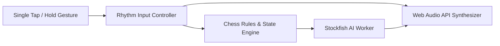

# Touch Chess: Non-Visual & Accessible Chess Engine

[](https://opensource.org/licenses/MIT)
[](#audio-feedback-system)
[](#features)
[](#architecture)

**Touch Chess** is a web-based, screenless/low-vision accessible chess client designed from the ground up for visually impaired players. By eliminating dependence on visual chessboards, it translates gameplay into an intuitive single-touch audio rhythm navigation protocol backed by the Stockfish engine.

---

## 🎧 Audio & Haptic Feedback Protocol

Rather than requiring precise screen-coordinate taps, navigation relies on cadence-based timing:

| Gesture | Action | Audio Feedback |
|---|---|---|
| **Single Tap** | Increment rank/file coordinate counter (1 through 8) | High-pitch tactile audio click |
| **Hold / Long Press** | Confirm coordinate / Lock selection | Resonant melodic chime |
| **Double Tap (Counter=0)** | Cancel selection / Go back one step | Dual descending tone |
| **Invalid Action** | Illegal move or out-of-bounds attempt | Low warning tone |

Opponent and engine moves are communicated back through directional melodic pulse sequences.

---

## ⚡ Architecture



---

## 🚀 Quickstart

Open `index.html` directly in any modern browser, or run via a local static server:

```bash
# Using Python
python3 -m http.server 8080

# Or using Bun / Node
npx serve .
```

Navigate to `http://localhost:8080`. Headphones or stereo speakers are recommended for spatial tone perception.

---

## 📄 License
Released under the [MIT License](LICENSE).
